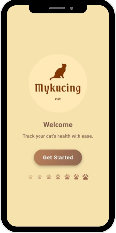
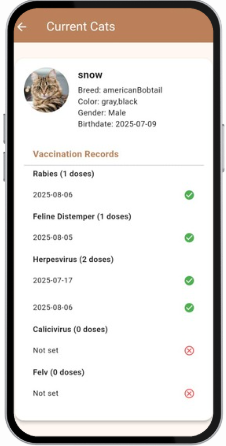
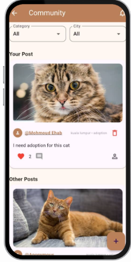
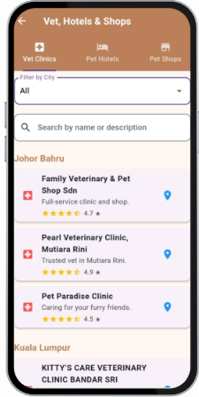

# 🐱 MyKucing — Cat Care Mobile Application

MyKucing is a multilingual mobile application that helps cat owners manage their cats' profiles, monitor their health, organize care reminders, and connect with other cat owners through a community platform.

Developed as a **Final Year Project** using Flutter and Firebase, with integrations for image uploads and location-based services.


## 📸 Screenshots

| Welcome | Profile |
|:---:|:---:|
|  |  |

| Community | Nearby Services |
|:---:|:---:|
|  |  |

## 📲 Download

[**Download MyKucing APK (Android)**](https://drive.google.com/file/d/1Amm2y1bsPwqhxCnp3VnkKaiWCvR046d-/view?usp=drive_link)

*Available for Android devices only.*

## ✨ Features

- **User Authentication** — Register, log in, and manage user accounts.
- **Cat Profile Management** — Create, view, update, and delete individual cat profiles.
- **Health Reminders** — Organize reminders for vaccinations, health checks, and other care activities.
- **Community Platform** — Share posts and interact with other cat owners across categories such as adoption, tips, grooming, funny moments, and cat sitting.
- **Image Uploads** — Upload cat images using the camera or gallery.
- **Nearby Pet Services** — Locate nearby veterinary clinics and pet hotels using Google Maps.
- **Multilingual Support** — English, Bahasa Melayu, Arabic, and Chinese.
- **Notifications** — Receive reminders about scheduled cat care activities.

## 🛠️ Tech Stack

| Technology | Purpose |
|------------|---------|
| Flutter & Dart | Cross-platform mobile development |
| Firebase Authentication | User registration and authentication |
| Cloud Firestore | Cloud database and real-time data management |
| Cloudinary | Cat image uploads and storage |
| Google Maps API | Nearby veterinary clinics and pet hotels |
| Provider | State management |
| Local Notifications | Scheduled reminders |
| Firebase Cloud Messaging | Push notification support, where configured |

## 📱 Application Modules

1. **Authentication** — Registration, login, account management, and input validation.
2. **Cat Management** — Manage cat profiles linked to the owner's account.
3. **Health & Reminders** — Create and manage reminders for vaccinations and health checks.
4. **Community** — Create and explore posts on adoption, care tips, grooming, funny moments, and cat sitting.
5. **Nearby Services** — Find nearby vet clinics and pet hotels with Google Maps.

## 🚀 Getting Started

### Prerequisites

- Flutter SDK and Dart SDK
- Android Studio or Visual Studio Code
- A Firebase project
- API credentials for Cloudinary and Google Maps

### Installation

1. Clone the repository

   ```bash
   git clone https://github.com/mahmoud-ehab20/MyKucing.git
   cd MyKucing
   ```

2. Install dependencies

   ```bash
   flutter pub get
   ```

3. Configure Firebase — set up your own Firebase project following the FlutterFire instructions, then enable **Authentication** and **Cloud Firestore**.

4. Configure external services — add your own Cloudinary and Google Maps credentials.

5. Run the app

   ```bash
   flutter run
   ```

> **Note:** Firebase configuration files and API keys are not included in this repository for security reasons.

## 🔐 Security Considerations

- Users must authenticate before accessing protected features.
- Firestore Security Rules ensure users can access only their own cat profiles and private data.
- User input is validated before processing.
- Private credentials are kept out of source control.

## 🎓 Project Information

- **Project Type:** Final Year Project
- **Development Period:** May 2025 – Sep 2025
- **Role:** Full-Stack Mobile Application Developer
- **Institution:** University Malaysia of Computer Science & Engineering (UNIMY)

## 👨‍💻 Developer

**Mahmoud Ehab** — Software Engineering Graduate

- [GitHub](https://github.com/mahmoud-ehab20)
- [LinkedIn](https://www.linkedin.com/in/mahmoud-ehab-hamada/)
